# Sistema de Inventario
Proyecto desarrollado en C# con Windows Forms, Guna.UI2, .NET 10 y SQL Server. Este permite administrar categorías, suplidores y productos, manejar fotografías de categorías y recuperar registros eliminados mediante una papelera.

## Funcionalidades

- Crear, editar y eliminar categorías, suplidores y productos.
- Buscar registros mientras se escribe.
- Filtrar productos por categoría, suplidor y rango de precios.
- Agregar hasta cinco fotografías por categoría.
- Validar campos obligatorios y formatos de datos.
- Evitar nombres duplicados.
- Realizar eliminaciones lógicas y restaurar registros.
- Registrar errores en un archivo de log.

## Requisitos

### Para ejecutar la aplicación publicada

- Windows de 64 bits.
- SQL Server Express LocalDB.
- Una instancia llamada `MSSQLLocalDB`.
- La base de datos `SistemaInventario` configurada.

El ejecutable publicado incluye .NET y las bibliotecas de la aplicación. La base de datos se configura por separado.

### Para abrir y modificar el código

- Visual Studio con soporte para .NET 10.
- Carga de trabajo **Desarrollo de escritorio de .NET**.
- SDK de .NET 10.
- SQL Server Express LocalDB.
- Una herramienta para ejecutar scripts SQL, como SQL Server Management Studio.

## Instalación y configuración

### 1. Extraer el proyecto

Descomprime el archivo en una carpeta de tu computador.

### 2. Instalar SQL Server LocalDB

La aplicación utiliza esta instancia:

```text
(localdb)\MSSQLLocalDB
```

### 3. Crear la base de datos

Conéctate a `(localdb)\MSSQLLocalDB` desde SQL.

Ejecuta los scripts de la carpeta `database` en este orden:

1. `schema.sql`: que crea la base de datos y sus tablas.
2. `datos.sql`: que agrega los registros iniciales.

### 4. Ejecutar la aplicación

Abre:
```text
build/SistemaInventario.Presentacion.exe
```
La aplicación utiliza autenticación integrada de Windows para conectarse a SQL Server.

## Ejecutar desde Visual Studio

1. Abre `src/SistemaInventario.slnx`.
2. Permite que Visual Studio restaure los paquetes NuGet.
3. Establece `SistemaInventario.Presentacion` como proyecto de inicio.
4. Comprueba que la base de datos esté configurada.
5. Compila y ejecuta la solución.

También se puede compilar desde una terminal ubicada en la carpeta principal con:

```powershell
dotnet restore src/SistemaInventario.slnx
dotnet build src/SistemaInventario.slnx
```

## Arquitectura

La solución está organizada en cuatro proyectos:

| Proyecto | Responsabilidad |
|---|---|
| Entidades | Representa los datos del sistema. |
| AccesoDatos | Contiene la conexión y los repositorios de SQL Server. |
| LogicaNegocio | Contiene servicios, validaciones y reglas de negocio. |
| Presentacion | Contiene los formularios y la interacción con el usuario. |

## Pruebas de funcionamiento

Se realizaron pruebas manuales de los formularios, las validaciones y las reglas del inventario. A continuación se presentan las capturas de los casos probados.

### 1. Pantalla principal

La pantalla principal muestra el menú de navegación y los totales de categorías, suplidores y productos registrados.

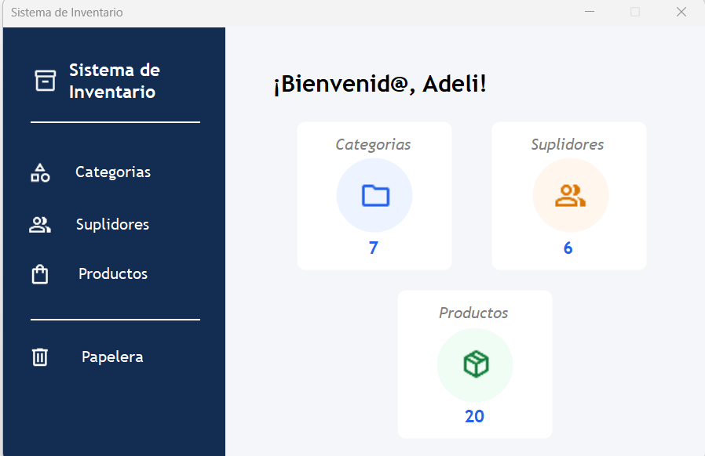

### 2. Categorías

El listado muestra el nombre y la descripción de las categorías, junto con las opciones para crear, editar y eliminar.

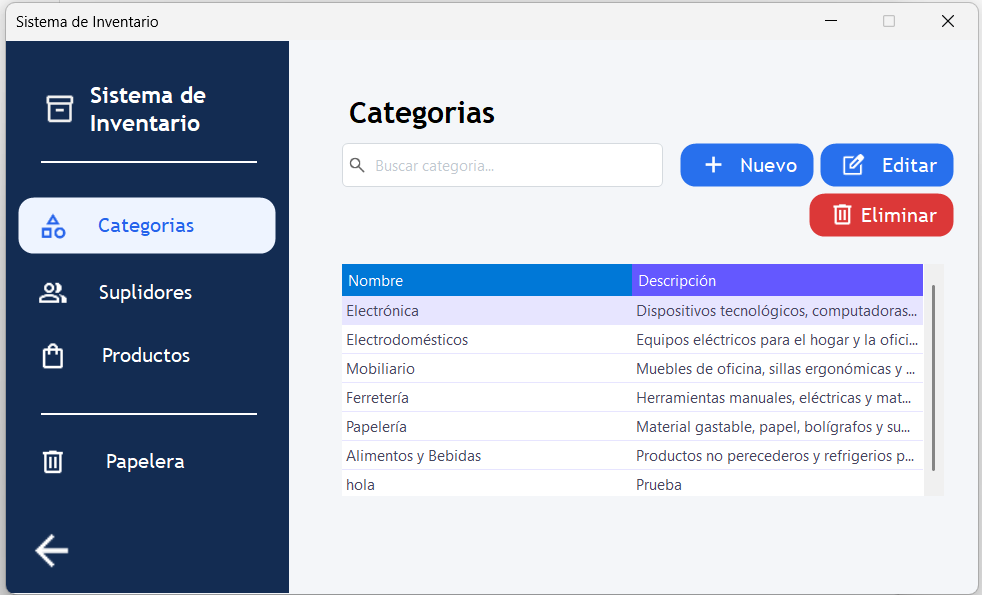

Se completó una categoría de prueba con nombre, descripción y una fotografía.

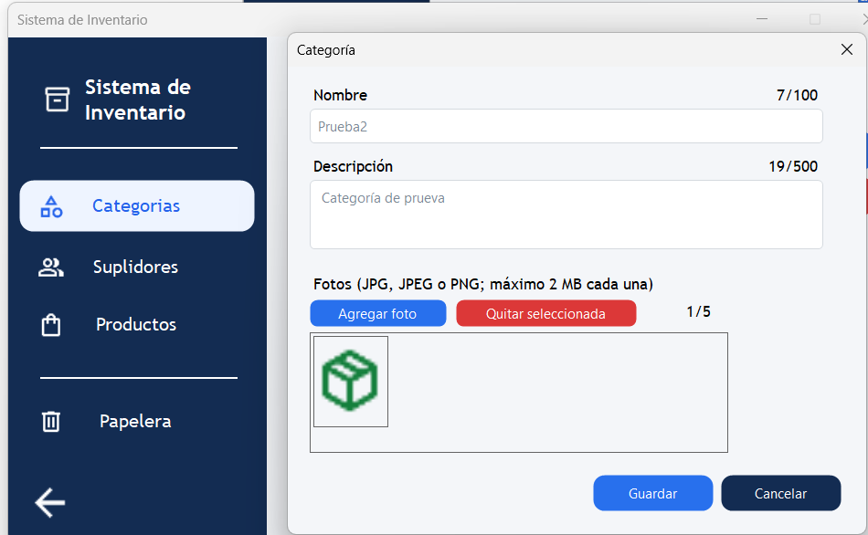

La categoría guardada aparece en el listado.

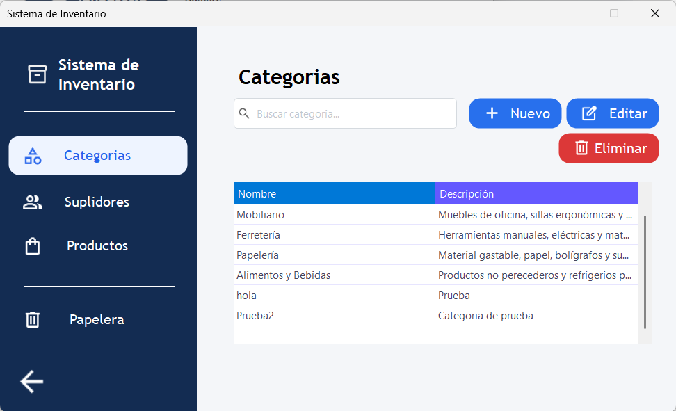

**Validación del nombre obligatorio:** al dejar el nombre vacío o con espacios, se muestra un aviso junto al campo.

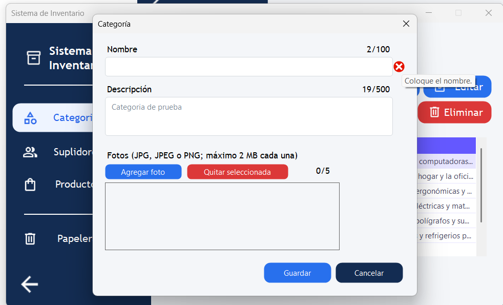

**Validación de longitud:** se rechazan los nombres demasiado cortos.

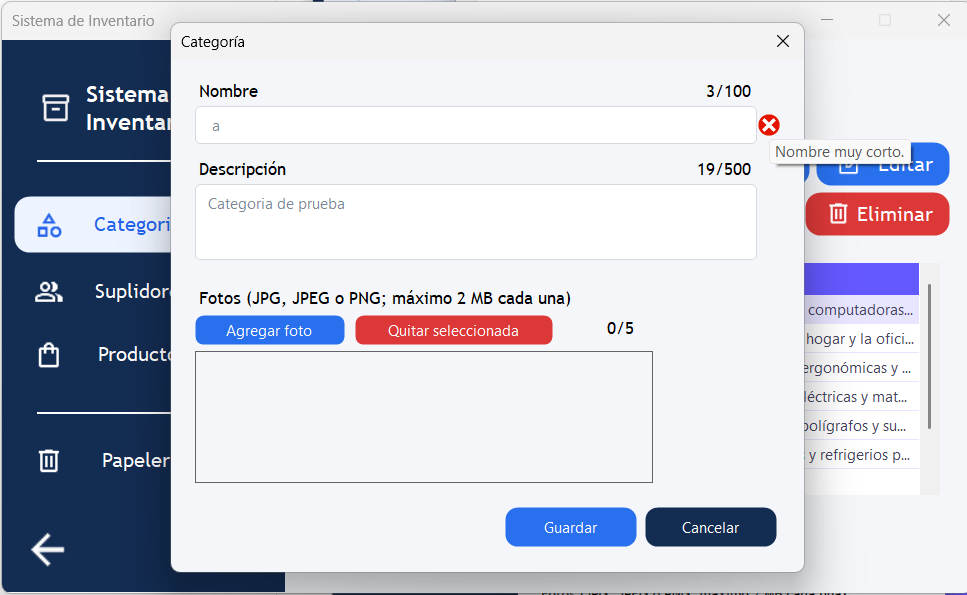

**Validación de duplicados:** no se permite registrar otra categoría con un nombre existente.

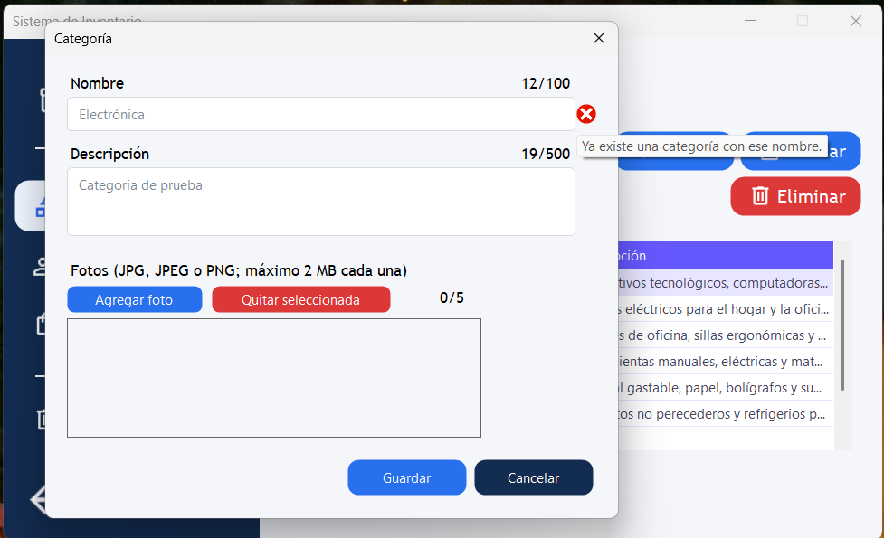

**Descripción obligatoria:** se muestra un error cuando el campo está vacío.

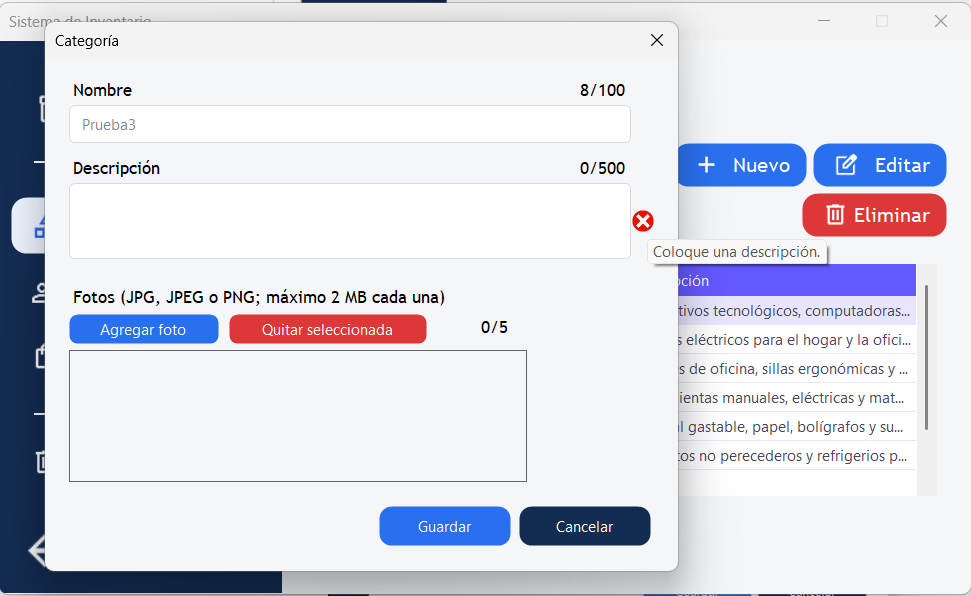

**Límite de fotografías:** al alcanzar cinco fotos, el sistema rechaza una adicional y muestra un mensaje explicando el límite.

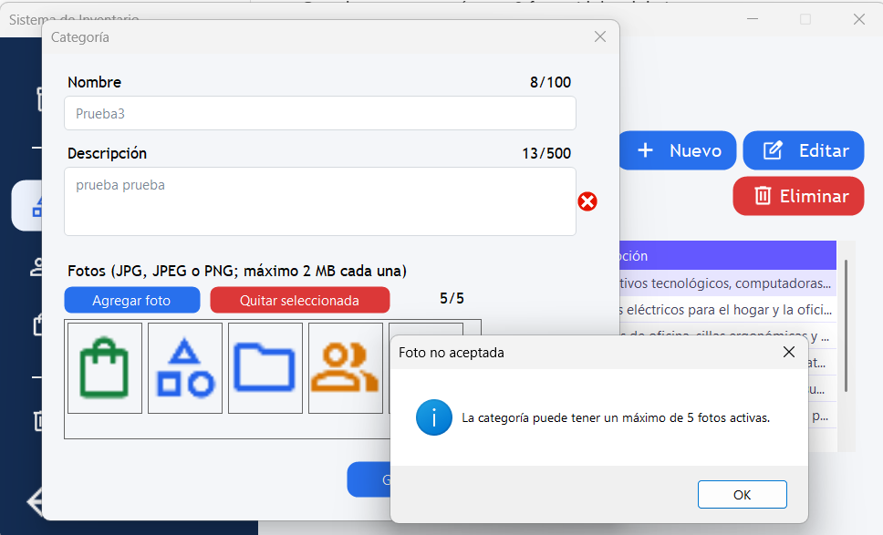

### 3. Suplidores

El listado presenta los datos de empresa, contacto, teléfono, correo electrónico y sitio web.

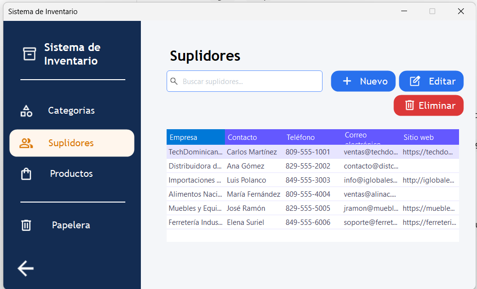

**Validación de duplicados:** al intentar guardar una empresa que ya existe, se muestra un error junto al nombre.

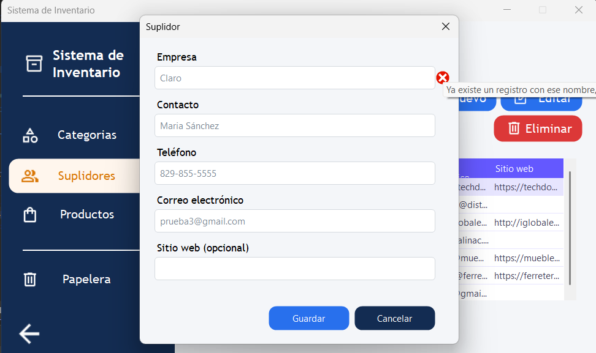

### 4. Productos

El listado muestra el producto, los nombres de su categoría y suplidor, y el precio unitario.

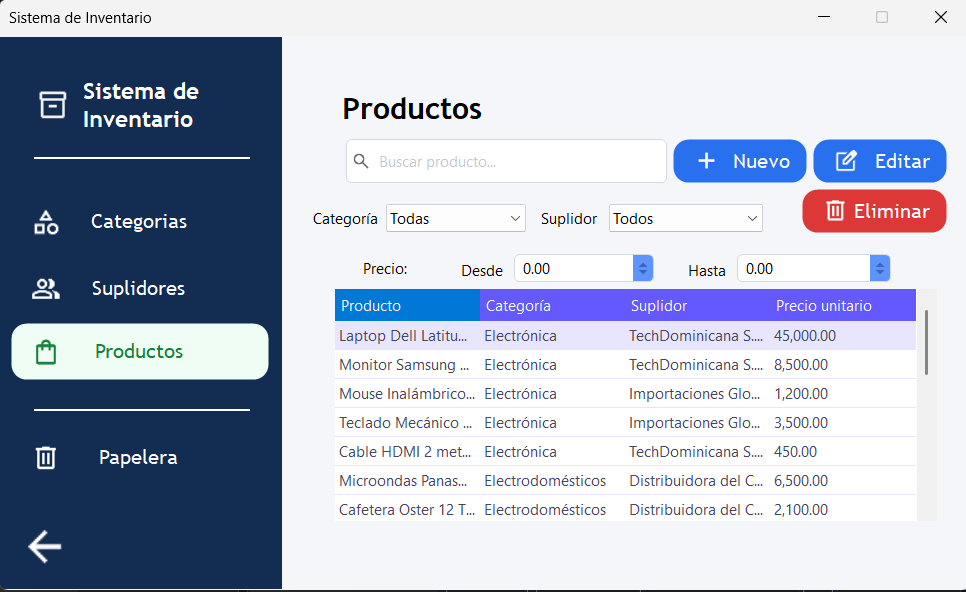

**Validación del precio:** al intentar guardar un producto con precio cero, aparece un error junto al campo.

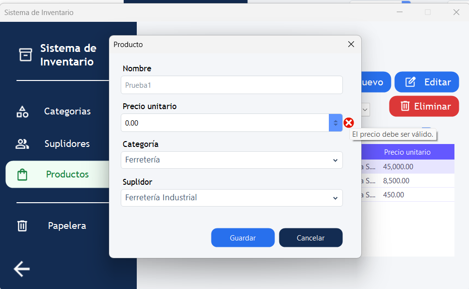

**Filtros combinados:** al seleccionar la categoría Electrónica y el suplidor TechDominicana, la tabla muestra los productos correspondientes a ambas selecciones.

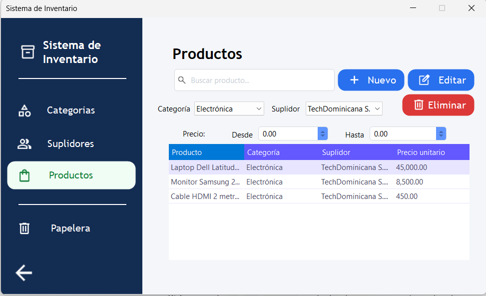

### 5. Eliminación y reglas de negocio

Antes de eliminar un producto, el sistema solicita confirmación e indica que podrá recuperarse desde la Papelera.

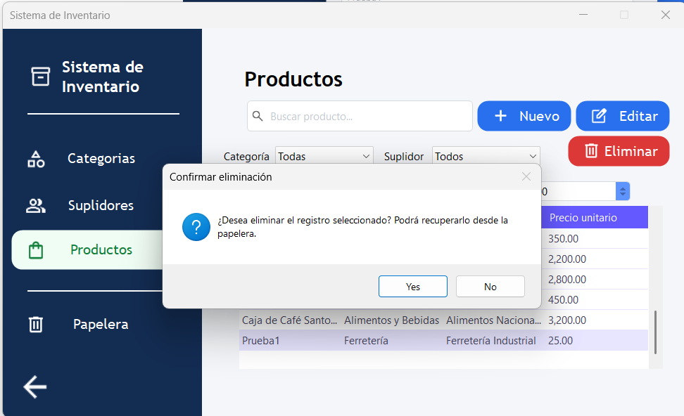

**Categorías con productos activos:** el sistema impide eliminarlas y explica el motivo.

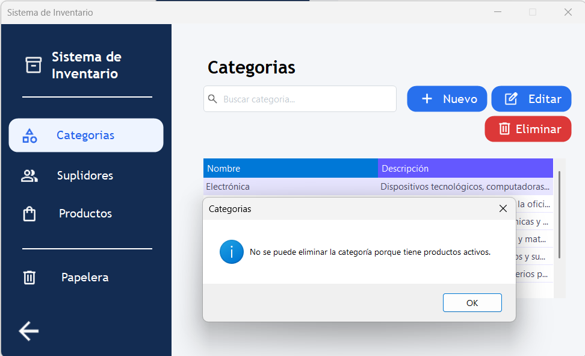

**Suplidores con productos activos:** también se bloquea su eliminación para conservar las relaciones del inventario.

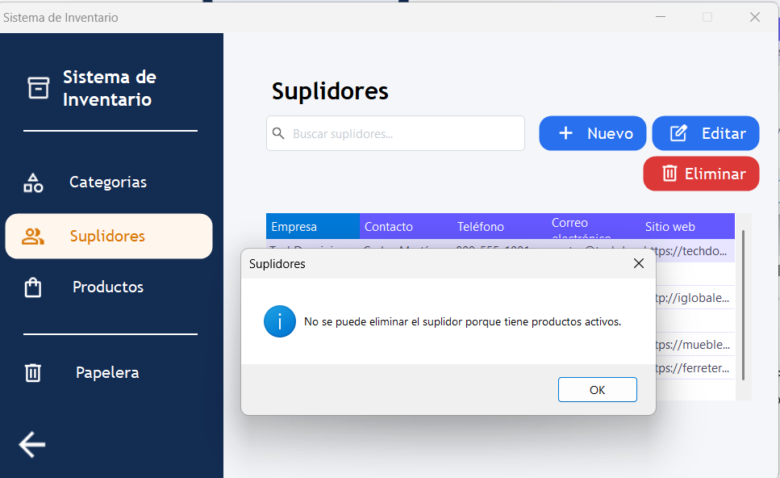

### 6. Papelera

El producto eliminado aparece en la pestaña Productos de la Papelera. Desde esta pantalla se encuentra disponible el botón **Restaurar seleccionado**.

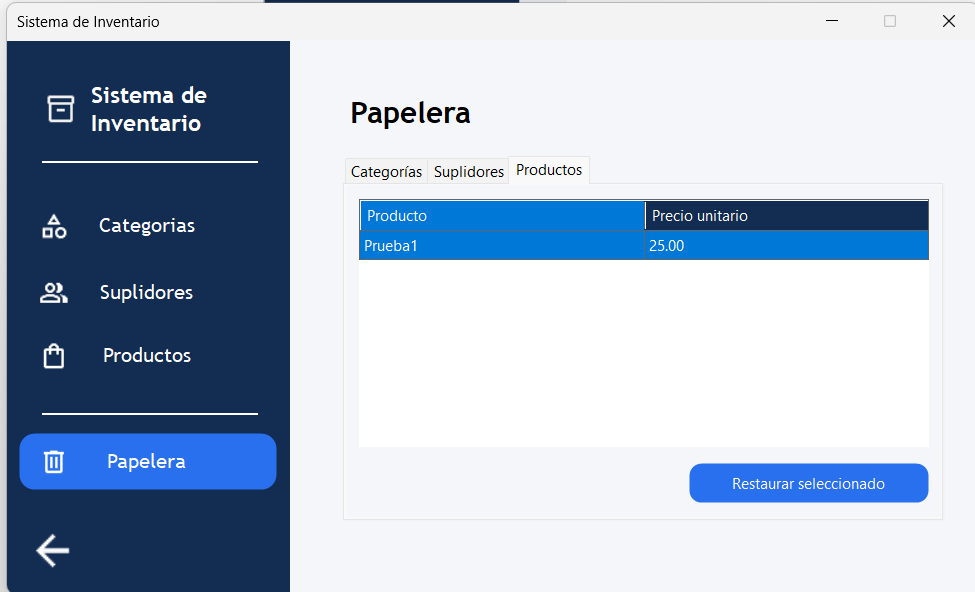
